<p align="center">
  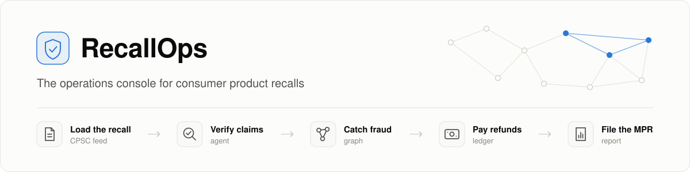
</p>

<p align="center">
  <a href="https://github.com/kartikeyamandhar/b2b_agent/actions/workflows/ci.yml"></a>
  <a href="https://github.com/kartikeyamandhar/b2b_agent/actions/workflows/deploy.yml"></a>
  
  
  
  
  
  
  
  
</p>

When a company recalls a consumer product in the United States, the press release is the easy part. The Consumer Product Safety Commission (CPSC) expects the firm to reach the owners, check every refund or repair claim, deliver the remedy, and file a **monthly progress report (MPR)** until the recall is complete. Most recalling firms are importers and mid-size brands, and they run all of this on a hotline, a spreadsheet, and a law firm.

**RecallOps does that work.** It reads the recall from the public CPSC feed and turns the free-text notice into rules a machine can check. Claims come in through a link-only portal, and a tool-using agent decides each one after reading the claimant's photos. Fraud rings are found across claims. Refunds go out through a ledger that cannot pay twice, and the monthly report is written from the data and reconciled to the unit.

**Try it live: [recallops-five.vercel.app](https://recallops-five.vercel.app).** Sign-up runs on a Clerk development instance, payments run in Stripe's test mode, and every claimant is synthetic. A new account starts with an empty workspace; ask the team to be invited to the demo firm with its 500 decided claims.

<p align="center">
  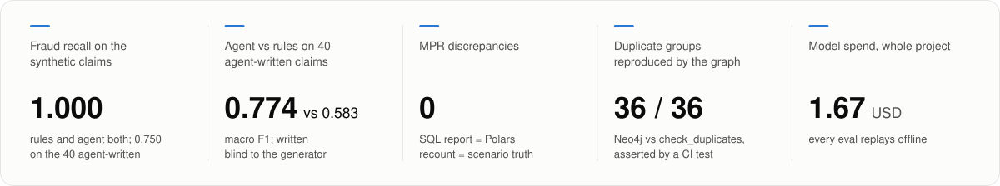
</p>

<details>
<summary><b>Contents</b></summary>

- [See it](#see-it)
- [How it works](#how-it-works)
- [The claims agent](#the-claims-agent)
- [Catching fraud rings](#catching-fraud-rings)
- [Money that moves once](#money-that-moves-once)
- [The monthly progress report, reconciled three ways](#the-monthly-progress-report-reconciled-three-ways)
- [How well it works](#how-well-it-works)
- [What keeps it honest](#what-keeps-it-honest)
- [Run it locally](#run-it-locally)
- [API tour](#api-tour)
- [Tech stack](#tech-stack)
- [Repository map](#repository-map)
- [Team](#team)
- [Further reading](#further-reading)

</details>

## See it

The firm's console, here on a real run: the agent read the claimant's label photo as model TL9000Q, checked it against the recall's only model, TL1302Z, and denied the claim with every reason tied to a rule or a check it ran.

<p align="center">
  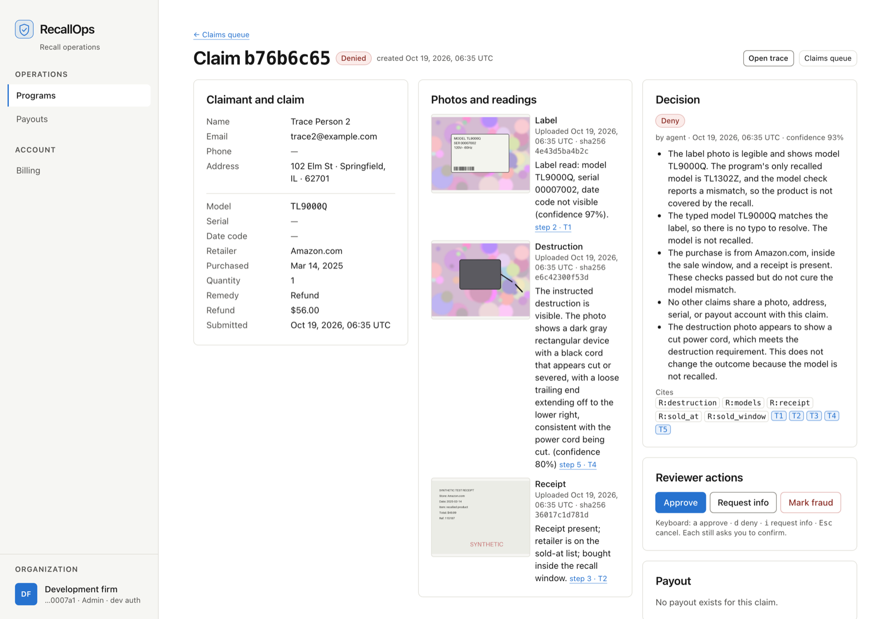
</p>

<table>
<tr>
<td width="50%">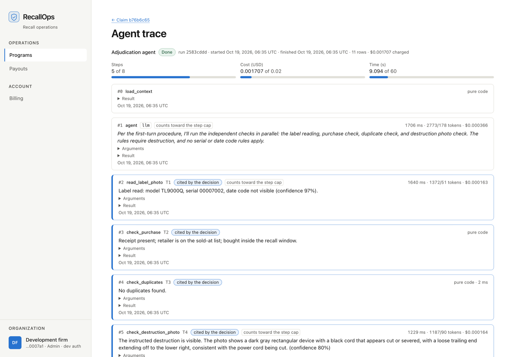</td>
<td width="50%">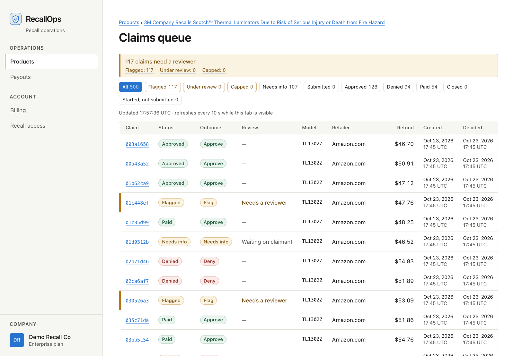</td>
</tr>
<tr>
<td valign="top"><sub><b>The trace.</b> Every step the agent took, with its cost and time against the run's caps, and the steps its decision cites.</sub></td>
<td valign="top"><sub><b>The queue.</b> The 500 seeded claims; the 117 that need a person are marked and counted at the top.</sub></td>
</tr>
<tr>
<td width="50%">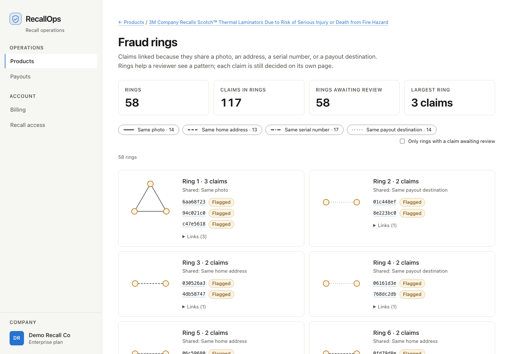</td>
<td width="50%">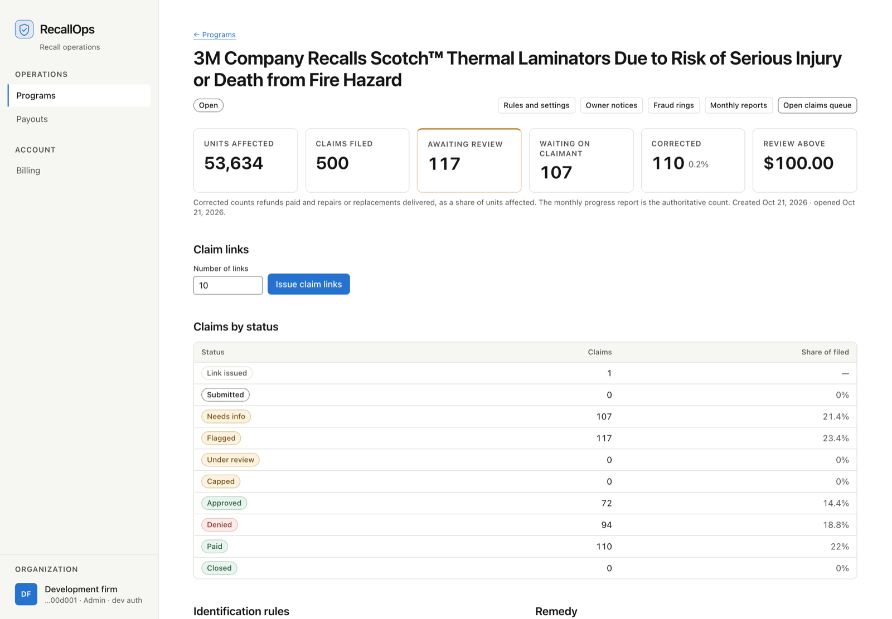</td>
</tr>
<tr>
<td valign="top"><sub><b>Fraud rings.</b> Claims that share a photo, an address, a serial number, or a payout account, drawn from the Neo4j graph.</sub></td>
<td valign="top"><sub><b>The program.</b> One recall's working file: units, claims by status, corrections, claim links, and the rules taken from the notice.</sub></td>
</tr>
</table>

<table>
<tr>
<td width="24%">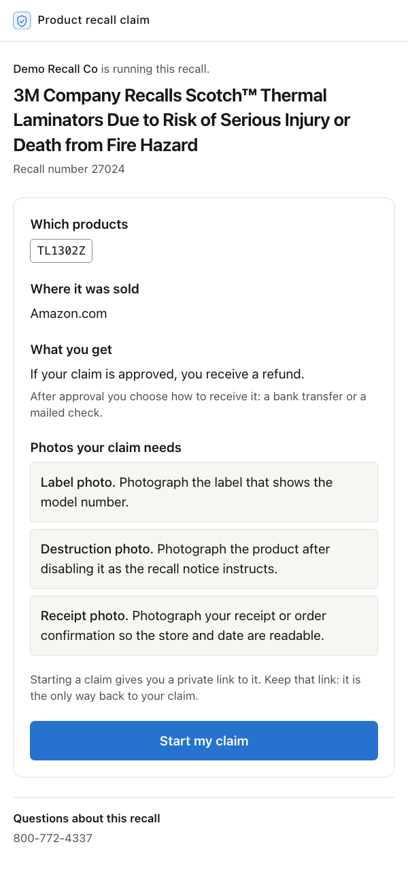</td>
<td width="24%">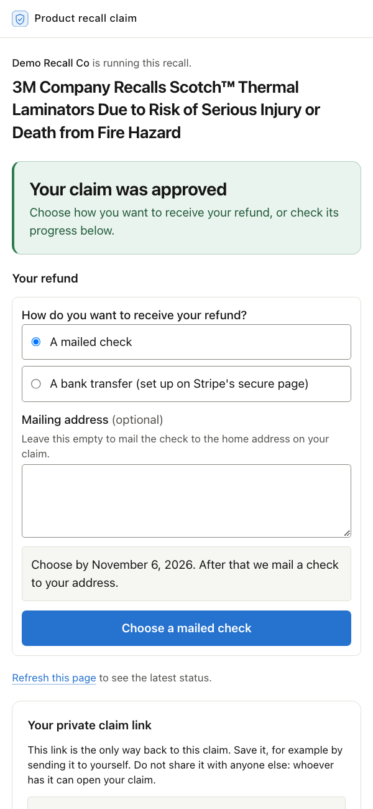</td>
<td valign="middle"><b>The claimant's side.</b> A company shares one link and QR code for its product. A claimant who starts a claim from it gets a private link to that one claim, with no account and no password, and files it in six short steps on a phone: confirm the product, take the three photos, say where it was bought, and submit. The same link then shows the decision in plain words, asks any follow-up question, and offers a mailed check or a Stripe bank transfer once the refund is approved. A person deciding the claim reads as "under review": the claimant never sees words like flagged.<br><br><sub>Everything on this page is synthetic data on the project's real recall; screenshots of the website in <code>apps/web</code>, built by the UI owner, in light mode (it follows the system's dark mode too).</sub></td>
</tr>
</table>

## How it works

<p align="center">
  
</p>

1. **Load the recall.** The API pulls the CPSC recall API in 30-day windows. A nightly GitHub Actions job is wired to trigger the pull and skips until the API is deployed; locally, `make seed` loads a fixture of 51 real records. Each notice becomes identification rules (model numbers, serial and date-code ranges, retailers, the sale window) and remedy rules (refund, repair, or replacement, and what the claimant must show). The regex extractor takes every value straight from the notice text, and the model-based fallback has any value it cannot quote verbatim from the notice dropped.
2. **Take claims.** Each product has one public claim link and QR code, which shows only the product's public facts. Starting a claim from it gives the claimant a private link to exactly one claim, with no account or password, and the claimant uploads a label photo, a photo of the destroyed product, and a receipt. In development the links carry plain `intake.<firm>.<product>.<version>` and `dev.<firm>.<claim>` tokens; with Clerk sign-in on, both are signed with HMAC-SHA256 under separate keys, a claim's link expires after 90 days, and replacing either link stops the old one.
3. **Decide each claim.** A polling worker runs the claims agent on every submitted claim, inside hard caps on steps, cost, and time. The model may be stricter than the rules table (the outcome the pure-code checks and the run's own photo readings give under the same policy), and a more lenient decision never takes effect on its own. A flagged claim, an approval over the program's money threshold, a run that hits a cap or fails, and a decision more lenient than the rules all stop and wait for a person.
4. **Catch fraud.** Reused photos, addresses, serial numbers, and payout destinations are caught when each claim is decided. A Neo4j graph then links them into clusters and rings for review.
5. **Pay.** An approved refund creates its payout row in the same transaction as the approval. Money can leave only through the ledger, as a check batch or a Stripe Connect transfer, never both and never twice. The Stripe calls belong to the payments component, implemented here in test mode; the development console and payment jobs drive the same ledger calls.
6. **Report.** The monthly progress report is computed in SQL, checked against an independent recount, and rendered to PDF.

Each firm's data is isolated by Postgres row-level security, forced on every tenant table. The graph is partitioned by firm too, so two firms never share a node.

## The claims agent

<p align="center">
  
</p>

The agent is a LangGraph loop with a Postgres checkpointer. It picks which checks to run, reads the photos with a vision model, and has to justify its decision: every reason cites a rule from the notice (`R:models`) or the result of a tool it ran (`T5`). A reason with no citation is rejected and the model gets one retry. Every step is written to one trace table, which the API serves at `GET /v1/claims/{id}/trace` for the console's trace viewer (pictured above).

Here is a real run, recorded live, for a claim whose label shows a model the recall does not cover:

| step | node | what happened | latency | cost (USD) |
|---|---|---|---|---|
| 0 | `load_context` | rules R:policy, R:models, R:sold_at, R:sold_window, R:receipt, R:destruction, R:value_threshold; three photos | 0 ms | 0 |
| 1 | `agent` | asks for four independent checks in one turn; the tools node runs them in order | 1,706 ms | 0.000366 |
| 2 | `read_label_photo` | **T1**: legible, model `TL9000Q`, confidence 0.97 | 1,640 ms | 0.000163 |
| 3 | `check_purchase` | **T2**: Amazon.com is a listed retailer, inside the sale window, receipt present | 0 ms | 0 |
| 4 | `check_duplicates` | **T3**: no shared photo, address, serial, or payout account | 2 ms | 0 |
| 5 | `check_destruction_photo` | **T4**: complies; "a black cord that appears cut or severed" | 1,229 ms | 0.000164 |
| 6 | `agent` | the label reads TL9000Q, not on the recalled list, so it confirms with `check_model` | 1,865 ms | 0.000393 |
| 7 | `check_model` | **T5**: mismatch against the recalled model `TL1302Z` | 0 ms | 0 |
| 8 | `agent` | calls `decide` | 2,652 ms | 0.000621 |
| 9 | `decide` | accepted: every reason is cited | 0 ms | 0 |
| 10 | `route` | **deny**, matches the rules table, no hold | 0 ms | 0 |

```text
outcome: deny        confidence: 0.93        total: 0.0017 USD, about 9 seconds

[R:models, T1, T5]   The label photo is legible and shows model TL9000Q. The program's only recalled
                     model is TL1302Z, and the model check reports a mismatch, so the product is not
                     covered by the recall.
[R:sold_at, R:sold_window, R:receipt, T2]
                     The purchase is from Amazon.com, inside the sale window, and a receipt is present.
                     These checks passed but do not cure the model mismatch.
[T3]                 No other claims share a photo, address, serial, or payout account with this claim.
[R:destruction, T4]  The destruction photo appears to show a cut power cord, which meets the destruction
                     requirement. This does not change the outcome because the model is not recalled.
```

<sub>The decision had five reasons; the second (the typed model matches the label, so there is no typo to resolve) is left out above for space. The run is claim C2 of the <a href="docs/traces/M2-adjudication.md">adjudication trace</a>, which records its outcome, its duration, its trace-row count (11), and its cost.</sub>

What a claimant uploads, and what the checks make of it:

<table>
<tr>
<td width="33%">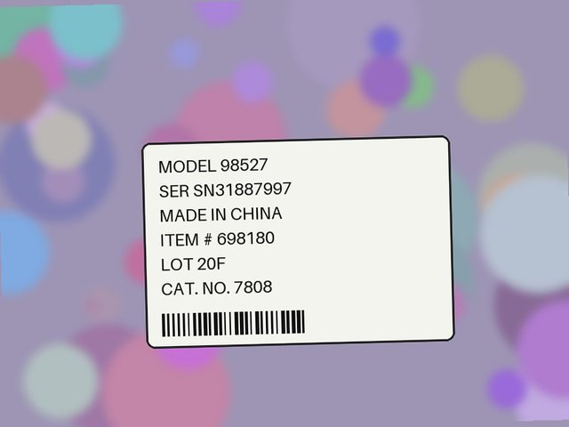</td>
<td width="33%">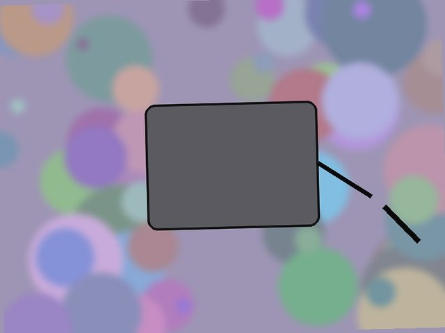</td>
<td width="33%">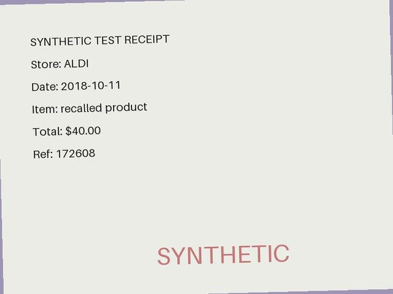</td>
</tr>
<tr>
<td valign="top"><sub><b>Label.</b> Vision reads the model as 98527 (confidence 0.9) and checks it against the notice's model list.</sub></td>
<td valign="top"><sub><b>Destruction.</b> The notice says to cut the power cord. Vision: "the cord appears severed with a visible gap between the two cord segments."</sub></td>
<td valign="top"><sub><b>Receipt.</b> No model reads it. The retailer and purchase date the claimant typed are checked against the notice's sold-at list and sale window, the receipt must be present when the remedy requires one, and its hash catches a receipt filed twice.</sub></td>
</tr>
</table>

<sub>Every claim, photo, and claimant in this repository is synthetic, rendered by the project's generator from real recall notices. No real consumer data is used anywhere.</sub>

## Catching fraud rings

<p align="center">
  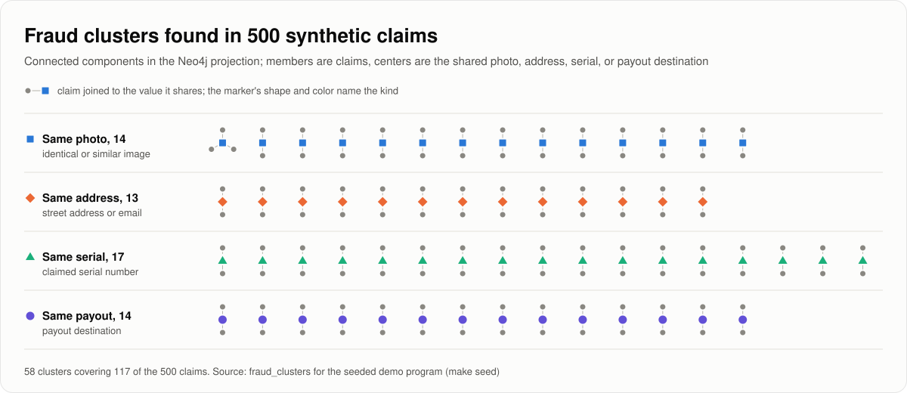
</p>

Fraud in a recall shows up as reuse: one label photo filed twice, one address behind several claims, a serial number that was already claimed, one payout account collecting many refunds. RecallOps looks for it in two layers.

- **When each claim is decided, in Postgres.** The duplicate check runs on every claim. If a duplicate arrives after the earlier claim was approved but before its money moved, the earlier claim is reopened and its payout held in the same transaction, and the adjudicator decides it again with the duplicate in view. No money leaves until it is settled, except a transfer already in flight, which is recorded with an alert if it lands. If the money already moved, the match goes to the audit log for review.
- **Across claims, in Neo4j.** Each decided claim is projected into a graph of claims and the identities they share. Connected components become the clusters a reviewer sees, and one query returns rings that mix kinds, such as an address shared with one claim and a payout account shared with another. On the 300 golden claims the graph reproduces all 36 duplicate groups exactly. Identity keys are keyed hashes, never a raw address or email.

The graph is a read-side projection. No claim status or payout depends on it, so the money path keeps working if the graph is down.

## Money that moves once

<p align="center">
  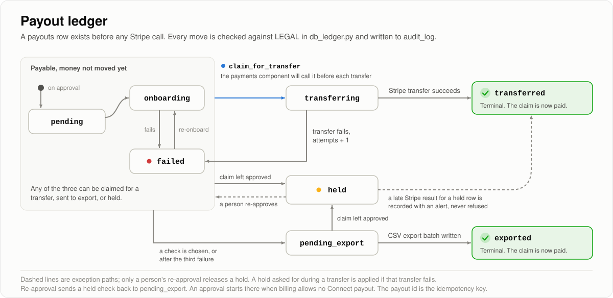
</p>

- **Ledger first.** A payout row exists before any Stripe call can be made, and its id is the idempotency key the payments component must send with the transfer.
- **Claimed before it is sent.** A transfer is claimed under a row lock, and a held payout can never be claimed. A hold requested while a transfer is in flight is recorded and applied if the transfer fails. A result that arrives for a held payout is recorded with an alert, never refused, so the ledger always agrees with Stripe.
- **Check batches in the database.** A payout waiting for a mailed check (the claimant chose one, three transfers failed, or the claimant did not choose a way to be paid within 14 days) joins the next export batch, and the batch file is written in the same transaction that marks its payouts exported. A committed batch always has its file, and two export runs can never pay the same claim. Cells are escaped so a spreadsheet cannot run them as formulas.
- **Redirects held.** A check sent to an address that another claim already uses goes to a person first.

## The monthly progress report, reconciled three ways

The report is aggregated in SQL. An independent recount over plain row exports, written in Polars with its own definitions, has to agree on every computed box. The test scenario also keeps its own ground truth as it writes the rows. All three agree in every month, with zero discrepancies, on a scenario built to trip careless definitions: a replayed delivery event, deliveries on the boundary instant between two months, claims answered the month after they were filed, repairs marked delivered, and a second program whose numbers must stay out.

| month | corrections (report / recount / truth) | cumulative | email contacts | discrepancies |
|---|---|---|---|---|
| 2026-08 | 19 / 19 / 19 | 19 / 19 / 19 | 161 / 161 / 161 | **0** |
| 2026-09 | 87 / 87 / 87 | 106 / 106 / 106 | 188 / 188 / 188 | **0** |
| 2026-10 | 68 / 68 / 68 | 174 / 174 / 174 | 153 / 153 / 153 | **0** |

Mutation tests plant the classic bugs, a month boundary off by one instant and a count of rows instead of distinct deliveries, and the reconciliation fails on each one. Full table: [evals/results/reporting.md](evals/results/reporting.md).

## How well it works

<p align="center">
  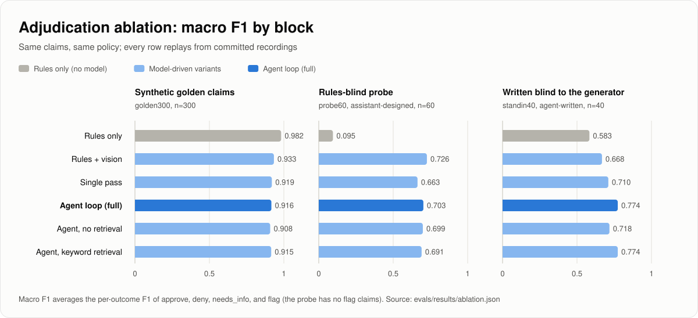
</p>

Six ways of deciding the same claims under the same outcome policy, on three blocks of claims. Every model call is recorded, so the whole table replays offline at no cost, and the deploy gate regenerates it on every pull request.

| adjudicator | synthetic golden (300) | rules-blind probe (60) | written blind to the generator (40) | model cost per claim |
|---|---|---|---|---|
| Rules only | **0.982** | 0.095 | 0.583 | 0 |
| Rules + vision | 0.933 | **0.726** | 0.668 | 0.0002 USD |
| Single pass | 0.919 | 0.663 | 0.710 | 0.0009 USD |
| **Agent loop** | 0.916 | 0.703 | **0.774** | 0.0016 USD |
| Agent, no retrieval | 0.908 | 0.699 | 0.718 | 0.0015 USD |
| Agent, keyword retrieval only | 0.915 | 0.691 | **0.774** | 0.0016 USD |

<sub>Macro F1 is the unweighted mean of the per-outcome F1 scores (approve, deny, needs_info, flag; the probe has no flag claims, so it averages three), so a rare outcome counts as much as a common one. The synthetic golden claims are 300 generated claims with known correct outcomes, made from the same rules the rules-only adjudicator applies, so it sits near its ceiling there. The probe is assistant-designed and the third block agent-written, as described below. Cost per claim is measured on the golden claims. Source: <a href="evals/results/ablation.md">evals/results/ablation.md</a>.</sub>

**What the numbers say, including where the agent loses.** Every expectation was written down before the runs, in [PREREG.md](evals/adjudication/PREREG.md), and the results are reported against it as they came out:

- **On claims generated from the rules, plain rules win**, 0.982 against 0.916. This was predicted, and it fires the kill criterion written down before the run: if the agent does not beat rules by more than 0.05 macro F1 on these claims, the agent has to earn its place elsewhere. Fraud does not separate them either. Every row uses the same pure-code duplicate check, so fraud recall ties at 1.000, and the agent's fraud precision is lower (0.947 against 1.000).
- **Where rules are blind, reading the photos is not.** A label photo can contradict or complete the typed model, a "destroyed" product can still have its cord intact, and a label can be unreadable. The probe is 60 assistant-designed claims built around those cases (50, plus 10 clean controls), so rules score 0.095 by design. The agent scores 0.703, and rules plus the two vision checks, with no loop, score 0.726.
- **The loop does best on the third block**: 40 claims written by a separate agent from four notices, without access to the generator, the tools, or the labels (their photos still come from the generator's renderer). The agent scores 0.774, against 0.583 for rules, 0.668 for rules plus vision, and 0.710 for a single pass over the same tools; the loop's edge over the single pass is 3 claims of 40.
- **Two expectations missed, and are reported as misses.** Retrieval helped by 0.056 on the third block (2 claims of 40), where it was expected to make no difference. And the vision check rejects many of the generator's compliant destruction photos: on the probe, every photo-reading row gets only 3 or 4 of the 10 clean claims right (rules alone get all 10), which keeps those rows under the 0.75 target. Here is one it rejected:

<table>
<tr>
<td width="40%">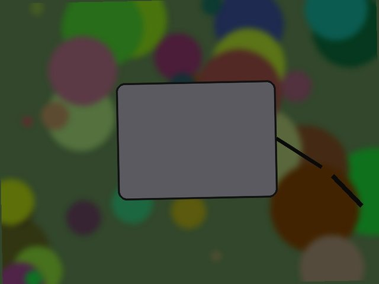</td>
<td valign="middle"><i>"The photo shows a gray rectangular device with a black cord trailing off its right edge, and the cord appears intact with no visible cut."</i><br><br><sub>The vision check, about a synthetic photo in which the cord is cut. The renders are too schematic for the model to accept as evidence (<a href="evals/adjudication/PREREG.md">PREREG.md</a>), but real photos show the check is strict too: see below.</sub></td>
</tr>
</table>

- **On real photos.** To separate the vision tools from our drawings, 64 photos that CPSC published with its recall notices were drawn by a seeded rule, labeled by two blind labelers who agreed on all 64, and run through both tools once (0.0094 USD; the gate replays it without the image files). Pre-registration and results: [evals/cpsc_photos/PREREG.md](evals/cpsc_photos/PREREG.md).

| what the tool should do | real CPSC photos | result |
|---|---|---|
| Read the model number | 20 readable labels | 18 read, 1 misread, 1 abstained |
| Never make one up | 20 with no readable model number | none invented; 2 returned another printed code (a style number, and "ITEM 61970") |
| Reject an intact product | 20 product photos | 20 rejected |
| Accept CPSC's own examples of correct destruction | 3 | **1 accepted** |

The label reader holds up on real labels. The weak link is one step later, matching what it read against the model list the regex extractor stored for the notice: 3 photos would deny a covered claim. One label prints "NZ-9160.4 5000 Y" where the notice lists "9160.4", the extractor kept only 2 of the 7 models in one notice's table, and "ITEM 61970" keeps its field word against the notice's item 61970. The destruction check is strict on real photos as well: it called a cut cord "intact" in CPSC's own example, so that claimant would be asked for another photo rather than paid. Sending a label-shows-another-model result to a person, reading whole model tables, and a revised destruction prompt are the next changes, each measured on this block before it ships.

- **Rule extraction.** On the 60 notices labeled blind, the regex baseline beats the model-based extractor on field accuracy, 91.8 against 87.9 ([evals/results/extraction.md](evals/results/extraction.md)). The model extractor therefore runs only as a fallback, as the kill criterion written before the run requires: if the regex baseline came within 5 points of the model, the model would be demoted.

## What keeps it honest

| | |
|---|---|
| **Tenant isolation** | Row-level security is forced on every tenant table. The API connects as a role that bypasses nothing and owns nothing. Tests prove that one firm cannot read, change, or delete another firm's rows, and that the graph never joins two firms. |
| **A budget the code enforces** | Every model call goes through one wrapper whose meter checks the projected cost before the call, against per-run caps and a global stop. The whole project has spent 1.63 USD on model calls. |
| **Replayable evaluations** | 3,493 recorded model responses (3,330 for adjudication, 100 for rule extraction, 63 for real recall photos) let every evaluation rerun offline, at no cost, with identical results. A freeze manifest pins the decision logic the recordings were made against. |
| **A gate that checks itself** | The deploy gate fails a change if any headline metric regresses past its tolerance, or if the committed results tables differ from what replay produces. |
| **Pre-registration** | Expectations and kill criteria are written down before each run. Misses are reported, not tuned away. |
| **Observed traces** | Every user-facing flow has a timeline recorded from a real run, not a description of what should happen. See [docs/traces](docs/traces). |
| **Synthetic data only** | Claimants, photos, and owner registrations are generated. Emails use example domains, phone numbers use the reserved 555-01xx block, and the registration upload refuses anything else. |

## Run it locally

You need Docker, [uv](https://docs.astral.sh/uv/) 0.11.21, Python 3.13, Node 22, and make. A machine without the images pulls them once: `docker pull pgvector/pgvector:0.8.6-pg16 && docker pull neo4j:2026.09.0-community`.

```bash
git clone https://github.com/kartikeyamandhar/b2b_agent.git recallops && cd recallops
cp .env.example .env
docker compose up -d      # Postgres 16 + pgvector and Neo4j, bound to 127.0.0.1
make setup                # pinned dependencies for the API and the website, database roles, migrations
make seed                 # a real recall, 500 synthetic claims decided, payouts, fraud clusters (about 50 s)
make dev                  # the API on http://127.0.0.1:8000, interactive docs at /docs
make web                  # in a second terminal: the console at http://localhost:3000/app/programs
```

`make seed` loads a fixture of 51 real CPSC records, opens a program for the Scotch thermal laminator recall (CPSC 27024) under a demo firm, and generates 500 claims and decides them with the rules-only adjudicator (no model calls). It then moves the approved refunds through the ledger and builds the fraud graph. The ids are deterministic.

Open **http://localhost:3000/app/programs**. Locally the console signs you in as the demo firm's admin (set `RECALLOPS_DEV_ROLE=reviewer` in `apps/web/.env.local` to see the reviewer's view). Open a claim to see its photos, decision, and trace; issue a claim link on the program page and open it to file a claim as an owner, from a phone-sized window if you like. The backend also serves a single-file **test console** at http://127.0.0.1:8000/dev/console that calls every route with the development sign-in; it is never served in production.

Then watch new claims get decided, in a third terminal:

```bash
P=0874f66f-bfb5-552b-bd93-6266f49c1d5a
PYTHONPATH=apps/api/src uv run --project apps/api --frozen python -m recallops.synth --program $P --n 20 --seed 7
ADJUDICATOR=rules_only make worker
```

`ADJUDICATOR=rules_only` runs offline at no cost. The agent itself (`ADJUDICATOR=agent LLM_MODE=live`, about 0.0016 USD per claim) needs an Anthropic key in `.env`, and every call goes through the cost meter.

Other targets: `make check` runs lint, strict type checks, and the backend test suite (527 tests, 90 percent coverage), and `make web-check` runs the website's type check and tests (556 tests). `make eval` reruns every evaluation from the recordings with no network. `make graph-sync` rebuilds the fraud graph from Postgres. `make help` lists everything.

It is live at **https://recallops-five.vercel.app**: the website on Vercel, and the API, the agent worker, and two scheduled jobs on Render from `infra/render.yaml`. [docs/DEPLOY.md](docs/DEPLOY.md) is how it was deployed and how to deploy it again, including what the first deploy found. The API runs with `APP_ENV=prod`, where the header-based development sign-in refuses to load: the deployed API accepts only Clerk session tokens and signed claim links, and it refuses to start on example, localhost, or plain-http Clerk and portal settings.

## API tour

<details>
<summary><b>Calls you can paste against a seeded local API</b></summary>

In development, requests authenticate with headers (`AUTH_PROVIDER=dev`). Errors are RFC 7807 problem details with a `correlation_id`.

```bash
B=http://127.0.0.1:8000
F=00000000-0000-4000-8000-00000000d001      # demo firm
G=00000000-0000-4000-8000-00000000d002      # other firm (5 claims)
P=0874f66f-bfb5-552b-bd93-6266f49c1d5a      # demo program
C=66dcc492-086f-5b59-b441-cbe001eb2e0b      # a demo claim
T=dev.$F.$C                                 # its portal token (dev tokens are dev.<firm>.<claim>)
A=(-H "X-Dev-Firm-Id: $F" -H "X-Dev-Role: admin")
R=(-H "X-Dev-Firm-Id: $F" -H "X-Dev-Role: reviewer")

# Health (readyz needs a worker heartbeat and reports the graph)
curl -s $B/healthz
curl -s $B/readyz

# Public archive search (full text)
curl -s "${R[@]}" "$B/v1/recalls?q=laminator&limit=5"

# Programs: list, read, and open one from a recall (rules extracted); PATCH /v1/programs/{id} edits and opens it
curl -s "${R[@]}" $B/v1/programs
curl -s "${R[@]}" $B/v1/programs/$P
RID=$(curl -s "${R[@]}" "$B/v1/recalls?q=laminator&limit=1" | python3 -c 'import json,sys; print(json.load(sys.stdin)["items"][0]["id"])')
curl -s -X POST "${A[@]}" -H 'content-type: application/json' -d "{\"recall_id\": \"$RID\"}" $B/v1/programs

# Claims queue, detail, photo, trace
curl -s "${R[@]}" "$B/v1/programs/$P/claims?status=flagged&limit=5"
curl -s "${R[@]}" $B/v1/claims/$C
curl -s "${R[@]}" $B/v1/claims/$C/trace

# The product's one public claim link: read it, then start a claim (each start returns the claim's own private link)
I=$(curl -s "${A[@]}" $B/v1/programs/$P | python3 -c 'import json,sys; print(json.load(sys.stdin)["intake_url"].rsplit("/", 1)[1])')
curl -s $B/portal/intake/$I
curl -s -X POST -H 'content-type: application/json' -d '{}' $B/portal/intake/$I

# Reviewer actions: resume_override, request_info, mark_fraud, mark_delivered
curl -s -X POST "${R[@]}" -H 'content-type: application/json' \
  -d '{"action": "request_info", "message": "Please send a clearer label photo"}' $B/v1/claims/$C/actions

# Fraud graph (Neo4j): rings across every duplicate kind, statuses from Postgres
curl -s "${R[@]}" "$B/v1/programs/$P/fraud-graph?limit=50"

# Payout export batches (the check/ACH fallback)
curl -s -X POST "${A[@]}" $B/v1/payouts/exports
curl -s "${A[@]}" $B/v1/payouts/exports

# MPR: generate (optional manual boxes) and read; the PDF is at /v1/programs/{id}/mpr/{report_id}.pdf
PERIOD=$(date -u +%Y-%m)
curl -s -X POST "${A[@]}" -H 'content-type: application/json' -d '{"incidents_after": 0}' "$B/v1/programs/$P/mpr/generate?period=$PERIOD"
curl -s "${R[@]}" "$B/v1/programs/$P/mpr?period=$PERIOD"

# Campaigns: synthetic owner registrations, match, drafts, simulated send
PYTHONPATH=apps/api/src uv run --project apps/api --frozen python -m recallops.synth --registrations owners.csv --program $P --n 40
curl -s -X POST "${A[@]}" -F file=@owners.csv $B/v1/programs/$P/registrations
curl -s -X POST "${A[@]}" $B/v1/programs/$P/campaign/match
curl -s -X POST "${A[@]}" -H 'content-type: application/json' -d '{"channels": ["email"]}' $B/v1/programs/$P/campaign/drafts
curl -s -X POST "${A[@]}" -H 'content-type: application/json' -d '{"channel": "email"}' $B/v1/programs/$P/campaign/send
curl -s "${R[@]}" $B/v1/programs/$P/campaign

# The signed-in account, the plans, usage, and test-mode billing
curl -s "${A[@]}" $B/v1/me
curl -s $B/v1/plans
curl -s "${R[@]}" $B/v1/usage
curl -s -X POST "${A[@]}" $B/v1/billing/checkout    # returns a Checkout URL after Stripe test configuration

# Claim portal (token in the path)
curl -s $B/portal/$T

# Tenant isolation: the other firm cannot see the demo firm's claim (404, not 403)
curl -s -H "X-Dev-Firm-Id: $G" $B/v1/claims/$C
```

The full contract is [docs/contracts/openapi.json](docs/contracts/openapi.json), also served live at `/docs`.

</details>

## Tech stack

| Layer | Choice |
|---|---|
| API and worker | Python 3.13, FastAPI, a polling worker on Postgres status columns (no queue) |
| Agent | LangGraph with the Postgres checkpointer; Claude Haiku through one metered wrapper |
| Data | Postgres 16 with forced row-level security; Polars for every tabular job |
| Fraud graph | Neo4j, projected from Postgres |
| Retrieval | Postgres full-text search for notices, because model numbers are tokens, not meanings; pgvector over a deterministic local hashed n-gram embedder for policy prose (lexical, not neural, so it needs no extra provider) |
| Photos | A storage seam: local disk in development, a private Supabase bucket in production, bytes proxied by the API |
| Quality | ruff, mypy strict, pytest with coverage, replayable evaluations, GitHub Actions with real Postgres and Neo4j |
| Sign-in | Clerk: session tokens verified against the instance's public keys, one company per account, and the platform operator recognized by a verified email address |
| Console and claim portal | Next.js 16, React 19, TypeScript, Tailwind 4; types generated from the API contract; every API call goes through the website's server |
| Payments | Stripe in test mode: Billing and the Customer Portal for firms, Connect for claimant refunds |

## Repository map

```
apps/web/            the console and claim portal (Next.js), talking only to the API through its own server
apps/api/            the backend: API, claims agent and worker, rule extraction, ingestion,
                     payouts ledger, monthly report, campaigns, fraud graph, evaluations
  migrations/        schema, forced row-level security, grants, triggers
  src/recallops/     one package per concern
  tests/             unit, database, and API tests
evals/               golden sets, pre-registrations, recorded model calls, results tables
docs/components/     the design of each component
docs/contracts/      the API contract and the change notes the other components code against
docs/onboarding/     where each component's owner started (history)
docs/traces/         timelines recorded from real runs
docs/assets/         the images on this page: the four diagrams are hand-written SVG; the three charts and the
                     sample photos are built by docs/assets/src (make readme-assets after make seed; the photos need ARGS=--photos)
infra/               deployment blueprint
data/samples/        the committed CPSC fixture; data/raw/SOURCES.md records where raw data came from
```

## Team

RecallOps began as a four-person team project for the UCLA MSBA program (fall 2026), one owner per component, working in parallel against a shared API contract. Since October 22, 2026 the backend owner builds every component alone.

| Component | Lives in | Status |
|---|---|---|
| Backend: API, agent, ledger, report, fraud graph, evaluations | `apps/api`, `evals` | Complete and tested; what this page describes |
| Firm console and claim portal | `apps/web` | Built by its owner against [the API contract](docs/contracts/openapi.json) and [the trace contract](docs/contracts/trace.md); adopted after a backend review that restyled it to match this page, fixed the portal's rate limit and other security findings, and closed the backend gaps its owner found |
| Payments: Stripe Billing and Connect | `apps/api/src/recallops/billing`, `apps/api/src/recallops/payouts/stripe_connect.py` | Built in test mode by its owner; adopted after a backend review that added regression tests for the payout and usage paths |
| Sign-in: Clerk and signed claimant links | `apps/api/src/recallops/auth` | Built by its owner (session verification, a firm created on first sign-in, 90-day signed links; since plan v3 one account is one company, with no organizations); adopted after a backend review that added a link-reissue route, production setting checks, and end-to-end tests |

Each component's design is in [docs/components](docs/components); [docs/onboarding](docs/onboarding) keeps where each owner started.

## Further reading

| | |
|---|---|
| [Backend design](docs/components/01-backend.md) | Schema, tenancy, the agent, tools, retrieval, the ledger, the report, the graph, and the gate tolerances |
| [Evaluation pre-registration](evals/adjudication/PREREG.md) | Every expectation, written before the run, and how each one came out |
| [Real-photo pre-registration](evals/cpsc_photos/PREREG.md) | The vision tools on 64 photos from CPSC's recall notices: selection, blind labels, and results |
| [Results tables](evals/results) | Extraction, adjudication, the ablation, the report reconciliation, and the vision tools on real CPSC photos, regenerated by `make eval` |
| [Runtime traces](docs/traces) | Real runs: claims through every adjudication path, payouts, the report, the fraud graph, a clean-clone setup |
| [Contract changes](docs/contracts/CHANGES.md) | What changed in the API contract, item by item |
| [Going live](docs/DEPLOY.md) | Every hosted service, setting, and secret, step by step, for one public link |


### Payments, in Stripe test mode

Built by the payments owner and adopted after a backend review: Checkout and the Customer Portal for a firm's subscription, signed Billing and Connect webhooks, plan limits and usage metering, and refunds to claimants through Connect (Accounts v2 recipients with an Express dashboard). Transfers keep the ledger-first rules above: a payout row before any Stripe call, the row id as the idempotency key, a hold that no transfer can pass, and an unknown Stripe outcome that stays open for reconciliation and is never turned into a check. Migration `0006_payments` adds the billing tables, with row-level security forced like every other tenant table. Everything runs offline in the test suite against a fake Stripe boundary; the payments owner's runs against a Stripe test account are recorded in [the sandbox trace](docs/traces/M4-payments-stripe-sandbox.md). Start with [the payments guide](docs/onboarding/payments.md) and [the runtime guide](docs/onboarding/payments-runtime.md).
